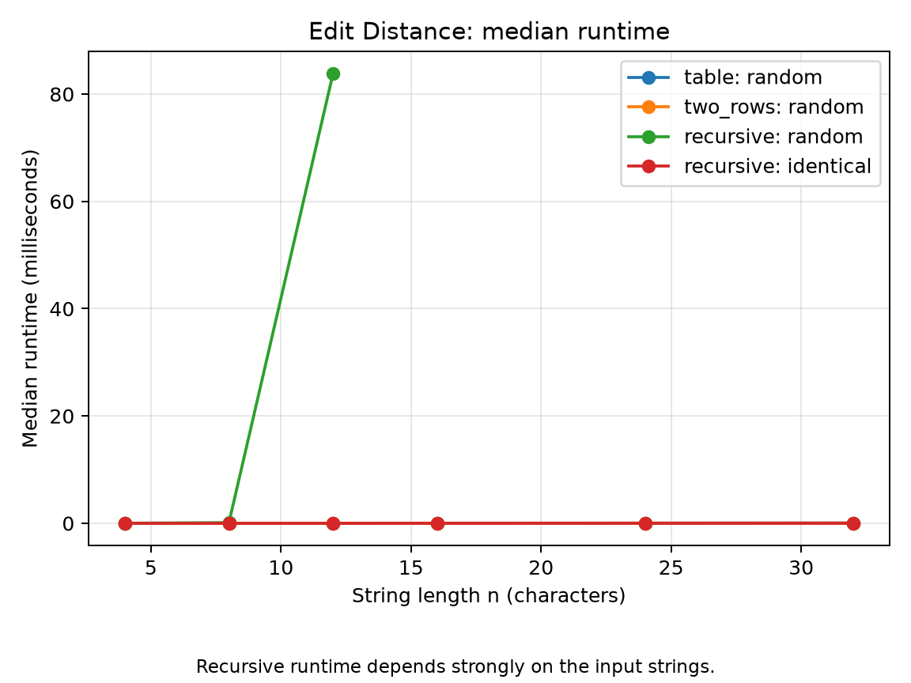
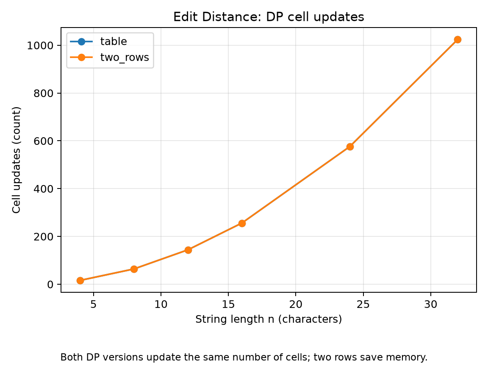
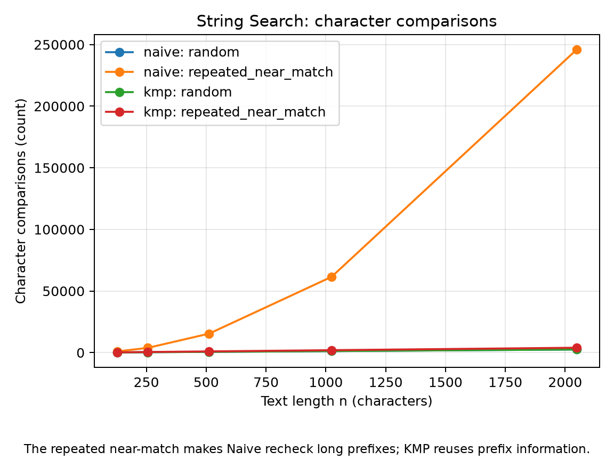
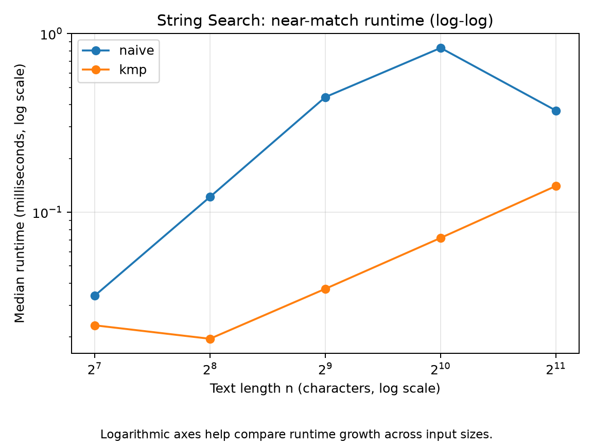

# Assignment 4 — Dynamic Programming and String Algorithms

## Experiment Design Card

| Field | Edit Distance | String Search |
|---|---|---|
| Question | How do recursive, full-table, and two-row implementations behave as input size grows? | How does KMP compare with Naive on random text and a repeated near-match? |
| Sizes | n = 4, 8, 12, 16, 24, 32. Recursive random inputs stop at n = 12 because recursion grows quickly. | Text length n = 128, 256, 512, 1024, 2048; pattern length is n/16, with a minimum length of 3. |
| Inputs | Random strings and identical strings. Random strings exercise recursive branching; identical strings show a low-work recursive case. | Random text and pattern; repeated near-match text `A...AB` and pattern `A...AB`. The near-match is intended to make Naive compare long prefixes repeatedly. |
| Metrics | Recursive calls or DP cell updates, counted inside each algorithm; runtime measured in milliseconds over 3 runs. | Character comparisons, counted inside each search algorithm; runtime measured in milliseconds over 5 runs. |
| Prediction | Recursive calls grow much faster than DP cell updates. Table and two-row versions do the same number of updates. | Naive makes many more comparisons than KMP on repeated near-match input. On random input, Naive may be competitive because mismatches happen early. |
| Plots | Runtime and DP cell-update plots compare growth and algorithmic work. | Comparison-count and log-log runtime plots show how input type affects search cost. |

## Plots and Results

*Median runtime in milliseconds. The recursive implementation grows faster than the dynamic programming implementations.*

*Both dynamic programming versions update the same cells; the two-row version stores less memory.*

*The repeated near-match causes more repeated comparisons for Naive than for KMP.*

*Logarithmic axes make it easier to compare runtime growth across input sizes.*

The experiment uses a fixed random seed (`20261108`), so the generated strings are reproducible. The CSV stores each run separately. Its counters are more useful than timing alone for understanding algorithmic work because timings can vary with the computer and Java runtime.

## Prediction versus Result

**Edit Distance.** I expected the recursive version to become expensive quickly because mismatches branch into three recursive calls. The table and two-row versions should update the same number of DP cells for a given pair of string lengths. The measurements and operation counts in `results/results.csv` can be used to check these predictions. Runtime is affected by the computer and Java warm-up.

**String Search.** I expected the repeated near-match input to be harder for Naive because it repeatedly compares long prefixes before finding a mismatch. KMP should reuse prefix information from the LPS array and avoid rechecking those characters. On random input, Naive can be competitive because a mismatch often happens quickly. The comparison counts in the CSV show how strongly the input affects the result.

## Short Answers

**Which input made string search slowest, and why?**  
The repeated near-match is designed to be hardest for Naive. Many starting positions share a long prefix with the pattern, so Naive repeats comparisons before each mismatch. KMP uses the LPS array to continue from a useful prefix position. The comparison-count plot shows this difference.

**How large an n could recursive Edit Distance handle, and what stopped it?**  
The experiment limits recursive random inputs to n = 12 to keep the run manageable. Recursive calls grow rapidly because the algorithm solves overlapping subproblems repeatedly. The recursive identical-string case is cheaper because matching characters follow only one recursive path.

**What do you gain and lose with two rows?**  
Two rows keep O(nm) running time while reducing auxiliary memory from O(nm) to O(m). They still return the same distance as the full table. The trade-off is that the full table is not available to reconstruct the sequence of edits directly.

**Which search would you choose for a city platform?**  
I would choose KMP when predictable performance matters, especially for long or repetitive strings. Naive is simpler and can work well for short patterns or random text. The comparison counters show why KMP is safer for inputs with repeated prefixes.

## One Paragraph on Time

Runtime is measured with `System.nanoTime` and repeated runs, but small measurements can be affected by Java warm-up, operating-system scheduling, and other programs. Therefore, I use the median time together with counters recorded inside the algorithms. The counters show the amount of algorithmic work more directly, while the CSV makes the experiment repeatable.